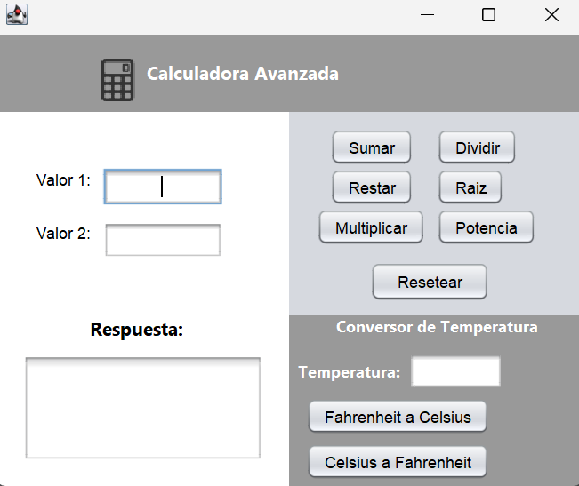
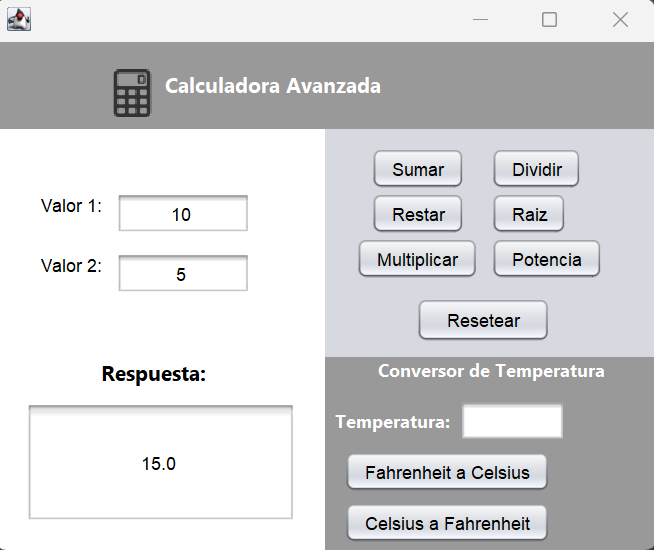
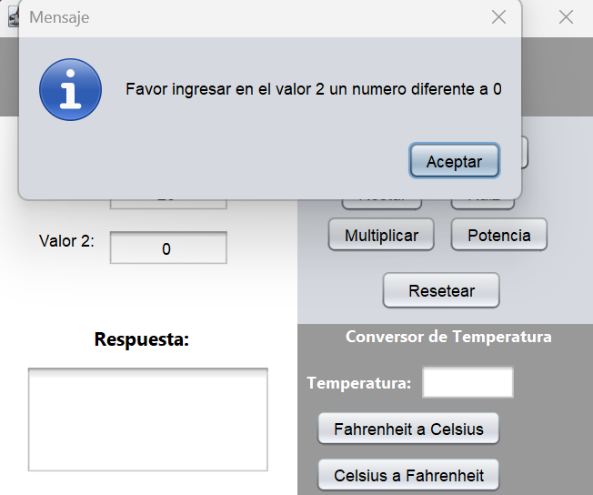
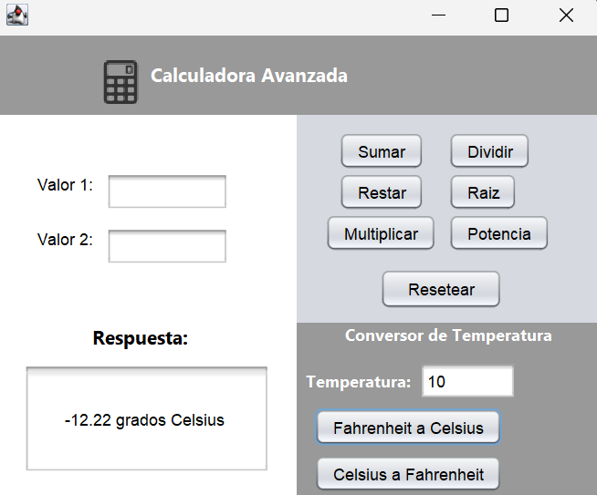

# 🧮 Calculadora Avanzada & Conversor de Temperatura

Una aplicación de escritorio desarrollada en **Java Swing** mediante **NetBeans IDE**. El proyecto implementa una calculadora funcional con operaciones aritméticas completas, funciones matemáticas avanzadas (potencia y raíz cuadrada) y un módulo de conversión de unidades de temperatura (°C / °F).

---

## 🛠️ Tecnologías Utilizadas

* **Lenguaje:** Java (JDK 8+)
* **Interfaz Gráfica:** Java Swing / AWT
* **IDE:** NetBeans IDE (GUI Builder)
* **Arquitectura:** Separación entre interfaz gráfica (`Main.java`) y clases de lógica de negocio (`Calculadora`, `Raizcuadrada_Exponente`, `ConversorTemperatura`).

---

## 🚀 Funcionalidades

### 1. Operaciones Aritméticas Básicas
* ➕ **Suma:** Suma de dos operandos.
* ➖ **Resta:** Resta de dos operandos.
* ✖️ **Multiplicación:** Producto de dos operandos.
* ➗ **División:** Cociente de dos operandos con **validación de división entre cero** mediante retroalimentación visual (`JOptionPane`).

### 2. Operaciones Matemáticas Avanzadas
* 📐 **Potencia:** Cálculo del primer valor elevado al exponente indicado en el segundo campo ($Valor_1^{Valor_2}$).
* 🌱 **Raíz Cuadrada:** Cálculo de la raíz cuadrada del primer operando ($\sqrt{Valor_1}$).

### 3. Conversor de Temperatura
* 🌡️ **Fahrenheit a Celsius:** $°C = (°F - 32) \times \frac{5}{9}$
* 🌡️ **Celsius a Fahrenheit:** $°F = (°C \times \frac{9}{5}) + 32$
* Formateo y redondeo automático del resultado a 2 decimales.

### 4. Validaciones e Interfaz de Usuario
* Restricción mediante teclado (`KeyTyped`) para permitir solo caracteres numéricos y puntos decimales.
* Validación de campos vacíos previa a la ejecución de cada operación.
* Botón **Resetear** para limpiar entradas y restablecer el foco en la interfaz.

---

## 📸 Capturas de Pantalla


### Interfaz Principal


### Operaciones y Validaciones
| Operación Aritmética | Validación División por Cero | Conversor de Temperatura |
| :---: | :---: | :---: |
|  |  |  |

---

## 📦 Estructura del Código

```text
src/
├── Main.java                     # Formulario principal Swing y controladores de eventos
├── Calculadora.java              # Lógica de operaciones básicas (+, -, *, /)
├── Raizcuadrada_Exponente.java   # Lógica de potencia y raíz cuadrada
└── ConversorTemperatura.java     # Lógica de conversión de °C y °F
